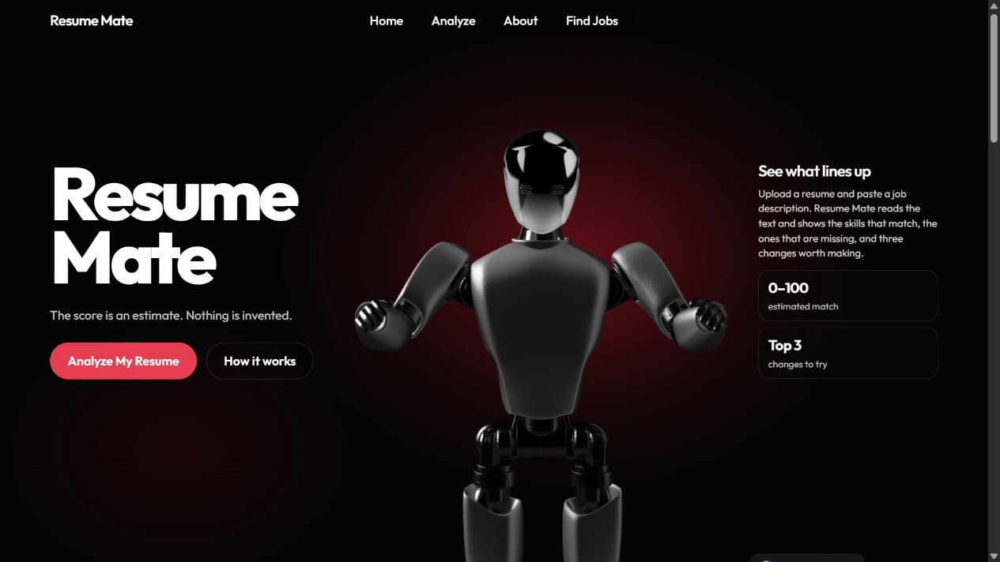
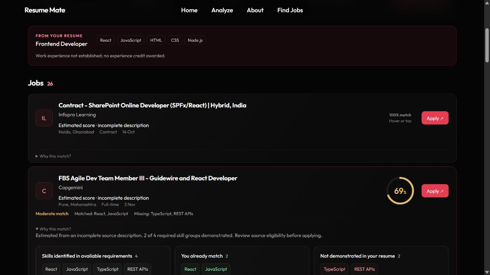
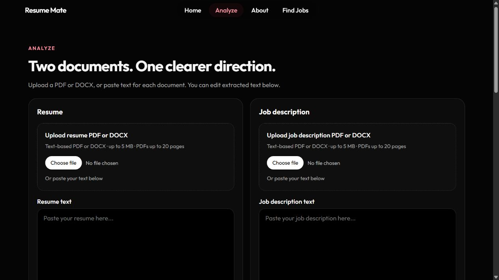
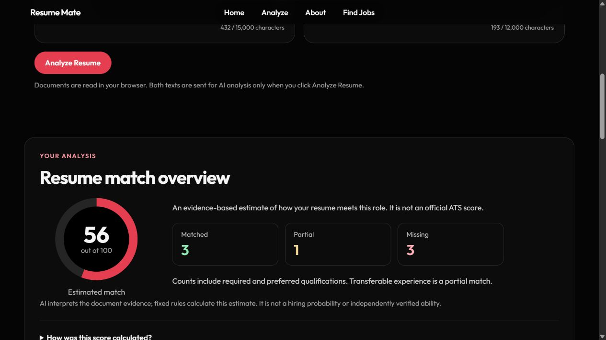
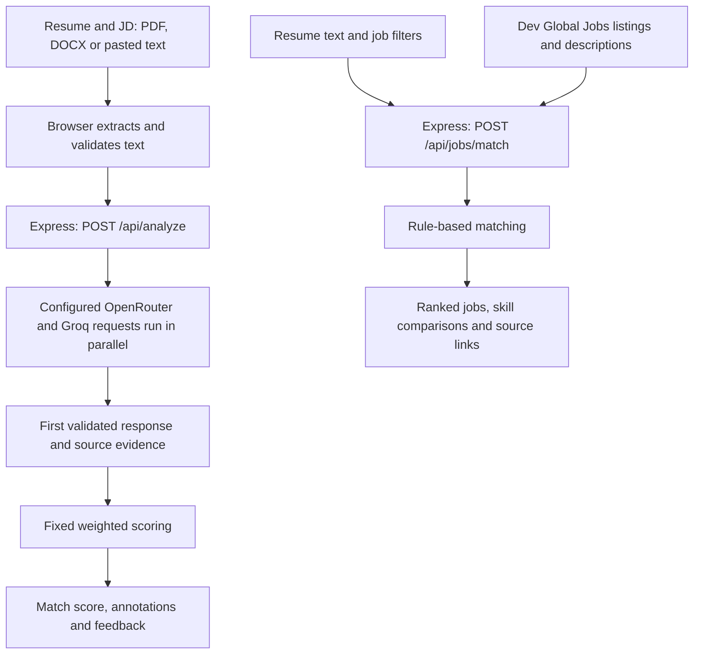

<div align="center">

# ResuMate

### Analyze smarter. Apply better.

**AI Resume Analysis · Skill Insights · Live Indian Jobs**

Upload your resume, understand how it fits a role, and explore jobs with the evidence behind each match.


**[Open Live Demo](https://resumate-p-mithils-projects.vercel.app/) · [Get Started](#getting-started) · [Meet the Team](#team)**

</div>

---

## A look inside

### The homepage

Black/red visuals, Outfit typography and an interactive Spline robot.



### Live jobs, with the evidence behind the score

Ranked source listings, circular compatibility indicators and expandable skill comparisons. Incomplete descriptions are explicitly marked as estimates.



<details>
<summary><strong>See resume upload and AI analysis</strong></summary>

### Two documents. One clearer direction.



### From document evidence to feedback



</details>

<sub>Actual screenshots of the deployed application. Analysis and job matching use a fictional test resume; displayed scores and listings are examples from that session, not promised outcomes.</sub>

---

## What you can do

| Resume analysis | Live Jobs |
| --- | --- |
| Upload a resume and JD as PDF or DOCX, or paste text | Browse Indian technology listings from Dev Global Jobs |
| Review and edit extracted text before analysis | Filter by city, job type, remote eligibility, posting window and fresher level |
| Compare required, preferred and partially matched qualifications | Compare resume evidence with available job requirements |
| Inspect matched/missing skills and source evidence | View calculated scores, sorted highest first, with unscored jobs kept visible |
| Read resume annotations, strengths and three prioritized improvements | Expand required, matched and missing skills before opening the source link |
| Open an explainable weighted-score breakdown | Reveal scores through hover, keyboard focus or mobile interaction |

The interface is responsive, supports keyboard interaction and respects reduced-motion preferences. No account or database is required.

> Match percentages are evidence-based compatibility estimates—not official ATS scores, hiring probabilities or proof of eligibility.

## How it works



Documents are extracted in the browser. Resume/JD text goes to the AI backend only when **Analyze Resume** is clicked. If both AI providers are configured, they run concurrently; the first validated result is used and the slower request is cancelled. Failed requests never generate a substitute score.

Jobs matching runs separately in Express. Resume text is not sent to the jobs provider or an AI model; only a derived role/technology search term may be used to fetch listings. Cached profiles and matching results reduce repeated work. Hovering never makes an AI request.

<details>
<summary><strong>How the scores are calculated</strong></summary>

| Factor | Resume/JD analysis | Resume-to-job matching |
| --- | ---: | ---: |
| Required qualifications | 45% | — |
| Preferred qualifications | 15% | — |
| Projects | 20% | — |
| Experience | 15% | 20% |
| Resume evidence | 5% | — |
| Skills | — | 40% |
| Role | — | 25% |
| Location | — | 10% |
| Education | — | 5% |

AI interprets the resume/JD evidence; application rules calculate the final analysis score. Matched criteria earn full credit, partial criteria half credit and missing criteria no credit. Inapplicable factors are excluded and remaining weights are redistributed.

Jobs use their own deterministic factors because a source listing differs from a submitted JD. Incomplete descriptions can receive explicitly labeled partial estimates when sufficient evidence exists. Unavailable scores remain unavailable, never an invented 0%.

</details>

## Tech stack

| Layer | Technologies and purpose |
| --- | --- |
| Interface | React, JavaScript and CSS; Outfit typography |
| Build tooling | Vite and the React plugin |
| Backend | Node.js and Express |
| Document reading | PDF.js (`pdfjs-dist`) for PDF; Mammoth for DOCX raw text |
| AI analysis | OpenRouter and Groq; server-side keys and validated structured responses |
| Job data | Dev Global Jobs API |
| 3D visuals | Spline viewer loaded from its CDN |
| Hosting | Vercel static frontend and an Express-backed Vercel Function |
| Regression checks | Built-in Node.js test runner; synthetic fixtures |

## Project structure

```text
FSD-Project/
├── src/
│   ├── pages/              # Home, Upload and Jobs
│   ├── components/         # Navigation, document inputs and results
│   ├── App.jsx             # Routes and shared Resume/JD state
│   ├── readDocument.js     # Common document validation and reading
│   ├── extractPdfText.js
│   ├── extractDocxText.js
│   ├── matching.js         # Resume/JD scoring rules
│   └── *.css
├── backend/
│   ├── server.js           # Express setup and API routes
│   ├── ai.js               # Parallel AI requests and cooldowns
│   ├── analyze.js          # AI prompt and evidence validation
│   ├── jobs.js             # Job matching orchestration and caches
│   ├── jobSources.js       # Dev Global Jobs fetching and normalization
│   ├── score.js            # Resume-to-job scoring
│   └── .env.example
├── api/index.js            # Vercel entry point for Express
├── tests/                  # Three focused regression tests and fixtures
├── docs/images/            # Genuine application screenshots
├── package.json
├── vite.config.js
└── vercel.json
```

## Getting started

Requires **Node.js 22.13 or later** and npm.

**1. Clone and install**

```sh
git clone https://github.com/P-Mithil/FSD-Project.git
cd FSD-Project
npm ci
```

**2. Configure the backend**

Copy [`backend/.env.example`](backend/.env.example) to `backend/.env`. Set at least one provider key; configure both to enable parallel requests.

```dotenv
OPENROUTER_API_KEY=your_openrouter_key
GROQ_API_KEY=your_groq_key
```

Model names are configurable through `OPENROUTER_MODEL` and `GROQ_MODEL`; defaults are supplied in the example file. Provider quotas and credit requirements still apply. Dev Global Jobs does not require a key in this implementation.

Keep keys in the backend environment. Never commit `.env` files or place secrets in `VITE_` variables.

**3. Start the API**

```sh
npm run dev:api
```

**4. In another terminal, start React**

```sh
npm run dev
```

Open **http://localhost:5173**. Express defaults to `127.0.0.1:3001`; Vite forwards `/api` requests to it.

| Route | Page |
| --- | --- |
| `/` | Homepage |
| `/analyze` | Resume/JD upload and AI analysis |
| `/jobs` | Live Jobs and resume matching |

<details>
<summary><strong>Tests, production build and deployment</strong></summary>

```sh
npm test
npm run build
npm run preview
```

The three focused tests cover AI validation/parallel requests/cooldowns, jobs/scoring/ranking/cache behavior, and document extraction/validation. They use controlled responses and synthetic documents; passing them does not prove live provider availability.

`npm run preview` serves the built frontend only. It does not start the Express API. `npm run start:api` starts Express without file watching.

For Vercel, import this repository with `main` as the production branch. [`vercel.json`](vercel.json) sets the Vite build, `dist` output, API routing and SPA fallback. [`api/index.js`](api/index.js) exports Express without starting a permanent server. Set provider keys securely for the required Preview/Production environments. Direct navigation and refresh use the SPA fallback for `/analyze` and `/jobs`.

Serverless caches and cooldowns are temporary per instance, not a persistent global store. The application respects `Retry-After` without automatic retry loops. API responses use `Cache-Control: no-store`.

</details>

## API endpoints

| Method | Endpoint | What it does |
| --- | --- | --- |
| `POST` | `/api/analyze` | Accepts `{ resumeText, jobDescription }`; returns validated AI evidence, a weighted score and feedback |
| `GET` | `/api/jobs` | Fetches and filters source listings; supports `city`, `type`, `days` and `level` |
| `POST` | `/api/jobs/match` | Accepts `{ resumeText, filters }`; returns ranked matches, skill evidence and unscored listings |

The backend validates input and limits JSON requests to 128 KB. Readable errors cover missing configuration, invalid input, provider failures, timeouts and rate limits. Previous results are preserved when an analysis request fails.

## Team

| Contributor | Feature responsibility |
| --- | --- |
| [Mithil](https://github.com/P-Mithil) | Live Jobs and resume-to-job matching |
| [Sanjay](https://github.com/sanjaypenta) | Resume/JD upload and document extraction |
| [Nishal](https://github.com/SAINISHAL) | AI analysis, scoring and feedback |
| [Moiz](https://github.com/Shaikmoiz) | Homepage, navigation and responsive UI |


<div align="center">

**ResuMate · Analyze smarter. Apply better.**

[Try the website](https://resumate-p-mithils-projects.vercel.app/) · [Browse the source](https://github.com/P-Mithil/FSD-Project)

</div>
